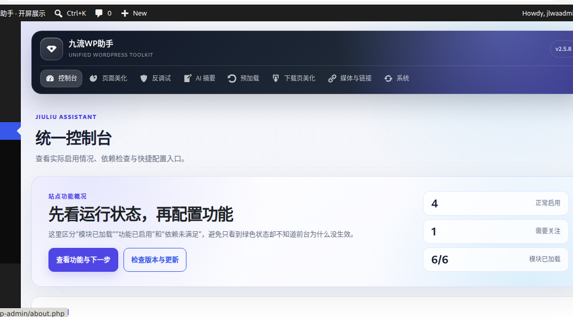
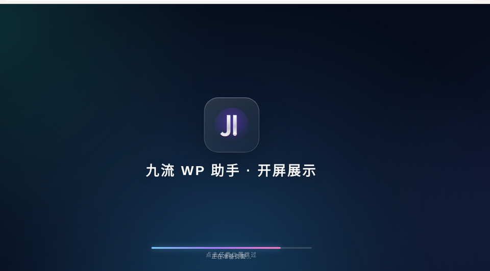
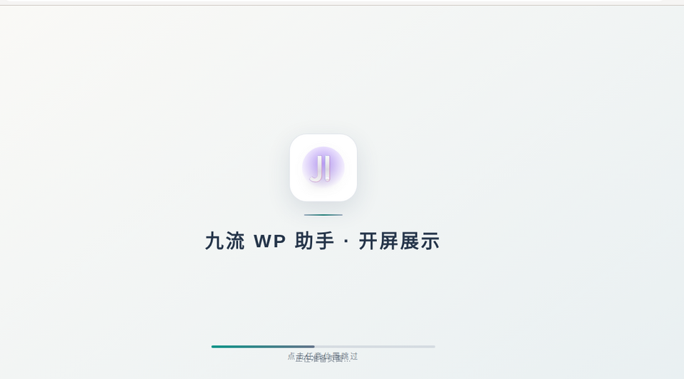

<div align="center">

# ✨ 九流 WP 助手

**一个插件，统一管理 WordPress 网站的视觉体验、内容智能与资源交付。**

六个功能域、一个后台控制台、一套设置与更新流程。支持按需启用、保留旧配置，并用明确的状态与操作指引减少配置成本。

[](https://github.com/nljie1103/wp-assistant/releases/latest)
[](https://github.com/nljie1103/wp-assistant/actions/workflows/test.yml)
[](https://github.com/nljie1103/wp-assistant/stargazers)
[](LICENSE)

[📥 下载最新版](https://github.com/nljie1103/wp-assistant/releases/latest) · [✨ 功能一览](#features) · [🚀 快速开始](#quick-start) · [🖼️ 实际界面](#screenshots) · [🔧 故障排查](#troubleshooting)

</div>

---

<a id="features"></a>

## 🧩 六个功能域，一套体验

| 功能 | 真实能力 |
|:---|:---|
| 🌸 **页面美化** | 樱花、雪花、落叶、气泡、星光流萤、微光流星、粒子连线、底部波浪、灯笼与鼠标交互；部分效果可独立调节数量与速度 |
| 🛡️ **反调试保护** | 对常见键盘操作、右键、复制等提供客户端阻碍；可另行配置服务端正文访问限制与紧急绕过 |
| 🤖 **AI 文章摘要** | 多服务商与模型、按服务商/模型保存 API Key、管理员按需显示已存密钥、连接测试、缓存及摘要外观 |
| 🌌 **沉浸式预加载** | 10 种开屏（含极光光幕、极简聚焦）、自定义 Logo、展示时长上限、首屏关键资源策略、移动端与减少动画适配 |
| 🔗 **媒体与链接** | 多入口域名适配、相对媒体 URL、反向代理诊断、历史内容扫描与确认后修复 |
| 📦 **下载页美化** | 6 种资源页外观、横竖封面自适应；复用子比主题原有下载与权限接口，不创建独立支付流程 |

**不是所有模块都默认启用。** 总览页区分“模块已加载”“功能已启用”和“依赖未满足”，并提示下一步操作。各模块有独立开关与设置，但共用主插件版本。

---

## 💻 环境与兼容边界

| 项目 | 要求或说明 |
|:---|:---|
| WordPress | 插件声明最低 5.8；曾在独立 WordPress 7.1.4 测试站点完成后台与部分前台验证 |
| PHP | 最低 7.4；自动化检查覆盖 PHP 7.4、8.3、8.4 |
| 下载页模板 | **依赖子比主题提供指定下载/付费函数**，检测不到接口时不会接管页面 |
| AI 摘要 | 需自行配置支持的服务商、模型与有效 API Key；连接成功还取决于站点服务器的外网访问能力 |
| 反调试 | **网页无法阻止用户通过浏览器菜单手动打开开发者工具**；需要真正保护正文时应使用服务端访问控制 |

> **部署和数据安全：** 更新前应备份 WordPress 数据库与 `wp-content`。媒体内容批量修改应先扫描、预览再确认；不要把 API Key 发布到网页或截图。新下载页风格没有代替子比的支付、会员和资源下载逻辑，实际付费交易需在你的子比环境验证后再启用。

<a id="quick-start"></a>

## 🚀 快速开始

1. 打开 [GitHub 最新 Release](https://github.com/nljie1103/wp-assistant/releases/latest)，下载 **`jiuliu-wp-assistant-版本号.zip`**。需要校验来源时，使用同版本的 `.zip.sha256.txt`。
2. 若仍在使用本项目原有的页面特效、AI 摘要、预加载或媒体链接**独立旧插件**，先确认迁移安排并停用相应旧插件，避免功能重复输出。
3. 进入 WordPress 后台 **插件 → 安装插件 → 上传插件**，选择下载的 ZIP 安装并启用。
4. 打开左侧的 **九流WP助手 → 助手总览**。先查看依赖与配置警告，再按需启用各模块。
5. 逐项保存设置，用未登录或无痕浏览器检查前台效果；涉及下载权限时分别验证未登录、已登录、已购买和未购买状态。

**更新：** 可通过插件的“系统与更新”检查完整发布包，也可以从 GitHub Release 获取官方 ZIP。在线更新会执行版本与 SHA-256 检查、暂存和回滚流程；服务器文件权限、磁盘空间与其他故障仍可能影响恢复，因此生产环境必须保留自己的备份。

---

<a id="screenshots"></a>

## 🖼️ 实际界面与开屏

下列图片来自本项目独立 WordPress 测试站点的**真实浏览器截图**，不是真实子比交易页面，也不代表所有主题视觉完全一致。开屏画面使用测试站点名称与插件内置示例 Logo。

### 后台：状态与配置入口



### 极光光幕 / 极简聚焦





开屏的动画持续时间、结束策略、Logo 与标题均在后台设置。两个新样式默认**不会擅自开启**；已有网站的原效果和已保存参数保持不变。

---

## 🎨 视觉方案与配置要点

| 模块 | 可选择的样式 | 建议 |
|:---|:---|:---|
| 页面氛围 | 樱花、雪花、秋叶、气泡、星光流萤、微光流星等 | 同时启用的动态效果越多，渲染成本越高；移动端会限制粒子数量 |
| 开屏预加载 | 立体 Logo、粒子、渐变、线条、玻璃、星轨、电影快门、水墨、**极光**、**极简** | 内容站优先考虑极简；不要把最大等待时间设得过长 |
| 下载页外观 | 科技蓝紫、简洁商务、VIP、**流光极光**、**杂志留白**、**曜石夜幕** | 新增三款共享原有资源、支付状态与下载按钮渲染，不另行实现支付 |
| AI 摘要 | 多种卡片样式、文字动效与颜色设置 | 先测试模型连接，再确认移动端展示、缓存策略与额度限制 |

### 🔑 管理员查看或更换 API Key

**AI 摘要 → AI 接口设置** 默认隐藏已经保存的密钥，不会在页面初始化时直接将密钥注入 HTML/JS。需要核对时，管理员可以点击 **“显示密钥”**，系统在权限及随机令牌验证后按需获取当前服务商的密钥；点击 **“隐藏密钥”** 会清除本次显示的内容。输入新值才更新当前绑定；留空保存保持已存密钥。

> 显示后的密钥在当前管理员浏览器中可见，也会经过一次受认证的 AJAX 响应。请勿在共享电脑上打开、录屏或复制到公开日志；这不是加密保险箱，也不能防范已取得管理员权限的人。

---

## 🏗️ 架构与项目结构

```text
wp-assistant/
├── jiuliu-wp-assistant.php        # 唯一 WordPress 插件入口
├── includes/
│   ├── class-jlwa-feature-registry.php  # 六个功能域的注册与加载状态
│   ├── class-jlwa-admin.php             # 统一后台
│   └── class-jlwa-updater.php           # GitHub Release 更新器
├── features/
│   ├── page-effects/             # 页面动画、交互与内容保护
│   ├── anti-debug/               # 反调试检测与保护范围
│   ├── ai-article-summary/       # AI 服务商、生成与缓存
│   ├── immersive-preloader/      # 10 种开屏与加载结束策略
│   ├── relative-media-urls/      # 媒体链接与扫描
│   ├── download-page.php         # 子比下载页功能入口
│   └── download-page-templates/  # 三套核心渲染模板
├── assets/                       # 后台 UI 与额外的下载页主题皮肤
├── docs/images/                  # 实际界面截图
├── tests/                        # PHPUnit、JavaScript、WordPress 冒烟测试
├── tools/check.sh                # 本地统一质量检查
├── CHANGELOG.md                  # 完整变更记录
└── LICENSE                       # GPL-2.0
```

本项目使用 **PHP + WordPress Hooks/Options、JavaScript、CSS/SVG**，没有额外的数据库服务。旧独立模块的目录不是多个可分别安装的主插件；安装与更新均以根目录插件入口为准。

### 💾 数据与保留边界

| 数据 | 存储方式 | 注意事项 |
|:---|:---|:---|
| 各模块配置 | WordPress `wp_options`，例如 `xjpe_options`、`wpaias_settings`、`jiuliu_immersive_preloader_options` | 插件版本升级通常不会重置；站点数据库备份应覆盖它们 |
| AI 文章摘要 | WordPress 文章元数据，例如 `_wpaias_summary_text` | 缓存可以重新生成，但可能产生额外 AI 请求成本 |
| 媒体扫描与修复 | WordPress 内容、设置或模块维护的数据 | 批量修复前须预览并备份；插件不会自动恢复外部备份 |
| 下载页封面及布局 | 模块设置和现有 WordPress 文章/媒体数据 | 模板不负责存储支付订单，使用子比主题现有逻辑 |

---

## ⚡ 性能与维护

- **只加载需要的前台功能。** 未启用的页面特效不放入访客的完整特效配置；新增星光与流星采用 CSS 合成动画，不开独立逐帧 JS 循环。
- **控制叠加成本。** 飘落类视觉效果共享数量预算，移动端和省流量场景进一步限量；尊重系统减少动画偏好。
- **尽量复用业务逻辑。** 三个新增下载页风格通过独立 CSS 皮肤复用同一套原有模板，而不是复制上千行交易代码。
- **生命周期和缓存。** 预加载包含结束超时和动画清理；前端资源使用插件主版本刷新缓存。

这些是**实现层面的优化**，不等于所有主题都有相同的加载加速幅度。本项目没有发布缺乏对照测试的“提速百分比”。

### 🧪 源码和集成检查

在已安装 PHP、PHPUnit 9、Node.js 的开发环境中，从仓库根目录执行：

```bash
bash tools/check.sh
```

该脚本执行 PHP/JS 语法、PHPUnit、Node 行为测试与中文发布命名检查。真实 WordPress 冒烟测试需另备独立测试站点，并使用 WP-CLI 运行 `tests/integration/` 下的测试；**不要直接在生产站点执行带测试数据的脚本**。

---

<a id="troubleshooting"></a>

## 🔧 常见问题

| 现象 | 建议检查 |
|:---|:---|
| 页面美化选项已开，但访客看不到 | 检查全局开关、移动端开关、减少动画、缓存/CDN 与主题是否输出脚本；使用管理员预览入口核对 |
| 开屏不显示 | 检查“仅首页”“标签会话仅显示一次”、移动端/省流量/减少动态策略及强制预览 |
| 点击显示 AI Key 失败 | 确认管理员登录未过期、权限与随机令牌有效；已保存密钥应和所选服务商/模型一致 |
| AI 测试连接失败 | 核对当前模型、Key、服务端 DNS/HTTPS/代理、第三方额度，**不要提交密钥到 Issue** |
| 下载模板不接管 | 检查子比主题是否具备下载与购买接口、下载文章的类型和模板匹配条件 |
| 系统更新失败 | 检查服务器能否访问 GitHub API、ZIP 下载和 SHA-256 文件、磁盘与文件权限；保留站点备份 |

---

## 📝 更新、反馈与许可

- **版本与更新日志：** [GitHub Releases](https://github.com/nljie1103/wp-assistant/releases) · [CHANGELOG.md](CHANGELOG.md)
- **问题反馈与建议：** [GitHub Issues](https://github.com/nljie1103/wp-assistant/issues)（提交日志前请删除 API Key、账户信息及私人内容）
- **许可证：** [GNU GPL v2 或更高版本](LICENSE)，以仓库实际授权文件和插件元数据为准。
- **维护者：** [nljie1103](https://github.com/nljie1103)

<div align="center">

**Made with ❤️ by 九流**

如果这个插件对你有帮助，欢迎在 GitHub 点亮 ⭐ Star。

</div>
