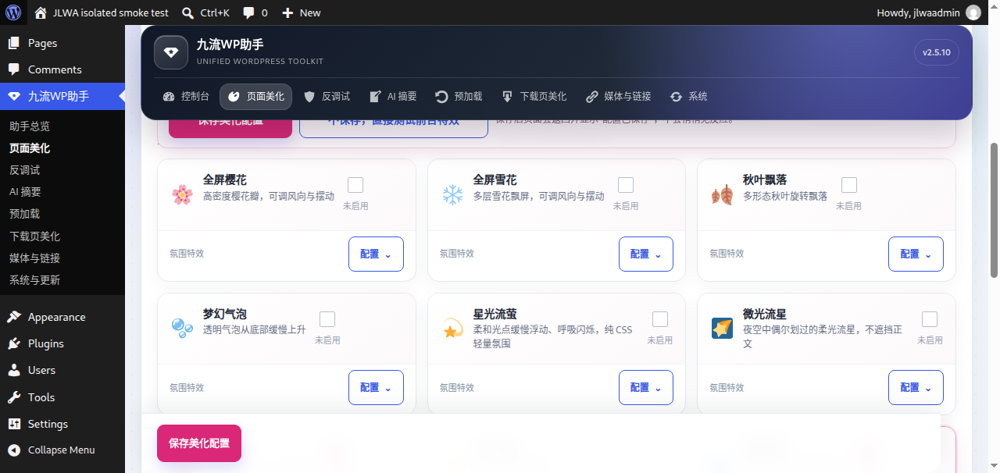
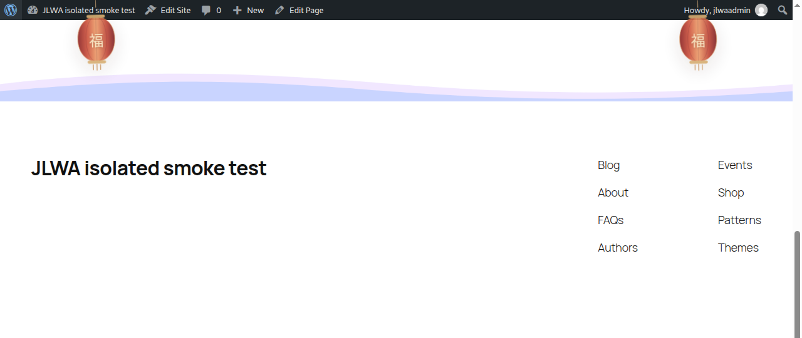
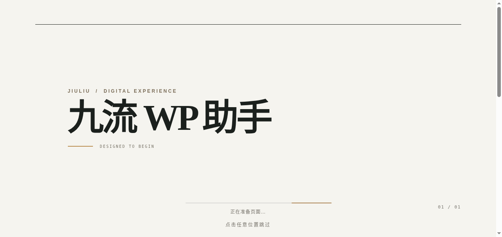
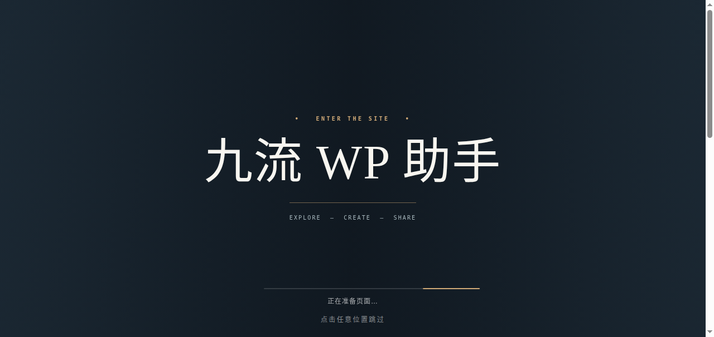

<div align="center">

# ✨ 九流 WP 助手

**一个插件，统一管理 WordPress 网站的视觉体验、内容智能与资源交付。**

七个功能域、一个后台控制台、一套设置与更新流程。支持按需启用、保留旧配置，并用明确的状态与操作指引减少配置成本。

[](https://github.com/nljie1103/wp-assistant/releases/latest)
[](https://github.com/nljie1103/wp-assistant/actions/workflows/test.yml)
[](https://github.com/nljie1103/wp-assistant/stargazers)
[](LICENSE)

[📥 下载最新版](https://github.com/nljie1103/wp-assistant/releases/latest) · [✨ 功能一览](#features) · [🚀 快速开始](#quick-start) · [🔐 安全部署](#paid-download-setup) · [🖼️ 实际界面](#screenshots) · [🔧 故障排查](#troubleshooting)

</div>

---

<a id="features"></a>

## 🧩 七个功能域，一套体验

| 功能 | 真实能力 |
|:---|:---|
| 🌸 **页面美化** | 18 项紧凑管理：樱花、雪花、星光、微光流星、柔和无缝波浪、纸艺灯笼、鼠标交互等；按需展开配置并支持筛选 |
| 🔐 **登录安全** | 彩虹聚合 OAuth 登录强制 Turnstile 人机验证：服务端 Siteverify、90 秒一次性准入、默认关闭；无需 CF 橙云代理 |
| 🛡️ **反调试保护** | 检测部分 DevTools 信号、阻碍快捷键与普通复制，支持安全能力自检；敏感内容依赖独立的服务端授权，不承诺阻止浏览器菜单或 JS 禁用 |
| 🤖 **AI 文章摘要** | 多服务商与模型、按服务商/模型保存 API Key、管理员按需显示已存密钥、连接测试、缓存及摘要外观 |
| 🌌 **沉浸式预加载** | 12 种开屏（含极光光幕、极简聚焦）、自定义 Logo、展示时长上限、首屏关键资源策略、移动端与减少动画适配 |
| 🔗 **媒体与链接** | 多入口域名适配（静态 CSS/JS 与图标字体同源改写可选）、分类设置、相对媒体 URL、扫描修复、可选 Nginx 静态缓存 |
| 📦 **下载页美化** | 恢复六款完整经典下载页布局，另提供不替换主题页面的原生兼容模式；客服／社群可配置，私有文件交付独立管理 |

### 🔑 登录安全：Site Key / Secret Key 在哪里获取？

前往 Cloudflare **Turnstile** 创建 Widget，然后将 **Site Key** 与 **Secret Key** 填入「九流 WP 助手 → 登录安全」。详细操作及密钥安全注意事项请看 **[Turnstile 密钥获取与配置教程](docs/turnstile-keys-guide.md)**（无需开启 Cloudflare CDN）。

**v3.1.3 新增登录安全：** 可为子比彩虹聚合 OAuth 发起入口强制启用 Cloudflare Turnstile 验证，不需要 Cloudflare CDN，且不修改主题 SDK 或回调。默认关闭，需自行配置有效密钥并实测中国大陆浏览器体验。参阅 [OAuth 登录安全部署说明](docs/oauth-turnstile-security.md)。

**v3.1.0 兼容与安全边界审计：** 修复多域名白名单改写遗漏子比 `/download?post=...` 和 `?jlwa_dl=` 票据的风险；全站预加载、页面特效（含输出缓冲）与严格反调试默认跳过子比登录、支付、订单和文件交付路由，避免遮挡或干扰原生处理。访客购买下载不再共用用户 ID 0 的限流配额，站内正规购买鉴权与 Nginx 源站封锁仍然有效。预加载杂志版不再写入作者品牌。详见 [子比原生兼容说明](docs/zibll-native-compat.md)。

**v3.0.9 站点通用化与私有中转验证：** 六款经典模板的站点标题改为自动读取 WordPress 网站名称，默认资源封面移除固定作者标识；会员权益入口改为可填写完整链接，旧站点已存在的会员页仍可识别。OpenList 原有授权后内部代理和独立出口票据链路没有删减，新增真实 PHP HTTP 中转回归测试；两种中转模式的启用条件见 [付费资源安全交付](docs/paid-download-security.md)。

**v3.0.8 恢复下载页并让多域名可选：** 完整恢复 v3.0.6 六款资源中心页面，默认启用“完整经典模板”，也能选“子比原生兼容皮肤”。原版布局与封面回退重新可用，WordPress 通过正常 `template_include` 选择完整模板，不再在 `template_redirect` 提前 include/exit。多域名普通展示仍保留；**全局动态 `home/siteurl` 单独增加高风险开关且默认关闭**，旧网站保存过的动态 siteurl 不会自行重新启用，只有管理员明确勾选才恢复旧功能。详见 [双模式兼容说明](docs/zibll-native-compat.md)。

**v3.0.7 子比原生优先：** 不再用 `pre_option_home`／`pre_option_siteurl` 修改 WordPress 站点身份；后台、AJAX、REST、子比 `/user-sign` 与支付／订单路径强制豁免域名转换。六款下载页皮肤现在直接增强子比自身渲染的下载页，不再 `include` 自定义 PHP 整页后 `exit`，由子比继续处理原生下载按钮与支付内容。需要留意：**新皮肤与旧完整自定义模板的布局并非逐像素相同**。已购资源的 OpenList 私有安全交付仍在必要的授权后文件钩子进行；详见 [子比原生兼容与上线验收](docs/zibll-native-compat.md)。

**严格模式登录兼容性已加固。** v3.0.5 起 Zibll 登录 /user-sign 自动豁免反调试；点击登录后暂停高风险动作，误报弱信号不再触发跳转，旧页面会话锁不会影响登录后返回。详见 [登录兼容性说明](docs/anti-debug-login-compat.md)。

**后台导航已改为顶部横向模式。** 站点在 WordPress 原生菜单下使用全宽工作台，顶部可直接进入全部七项功能、控制台和系统与更新；窄屏可横向滑动菜单，原有搜索、通知和深色模式不变。

**七个功能区的组件外观也已经统一。** 后台板块、卡片、悬停反馈、表单、状态、通知和危险确认均按同一套规则显示；卡片不再有的悬浮有的不浮动。详细规则见 [后台组件设计规范](docs/admin-design-system.md)。

**不是所有模块都默认启用。** 总览页区分“模块已加载”“功能已启用”和“依赖未满足”，并提示下一步操作。各模块有独立开关与设置，但共用主插件版本。

---

**Nginx 可选配置：** 已能通过多域名访问和媒体 URL 转换的网站不必额外安装 Nginx 缓存。仅独立反代站点可通过插件后台生成预览、部署和回滚命令，详见 [独立反代静态缓存教程](docs/media-nginx-optional.md)。

## 💻 环境与兼容边界

| 项目 | 要求或说明 |
|:---|:---|
| WordPress | 插件声明最低 5.8；曾在独立 WordPress 7.1.4 测试站点完成后台与部分前台验证 |
| PHP | 最低 7.4；自动化检查覆盖 PHP 7.4、8.3、8.4 |
| 下载页布局 | 经典模式恢复完整 PHP 资源中心模板，原生模式使用轻量 CSS 皮肤；两种模式均需已购授权，未购页面在服务端提前阻断 |
| 私有付费下载 | 需子比主题钩子、Nginx `internal` 及源站封锁；自动部署需一次性管理员授权，默认不开启源站封锁 |
| AI 摘要 | 需自行配置支持的服务商、模型与有效 API Key；连接成功还取决于站点服务器的外网访问能力 |
| 反调试 | **网页无法阻止用户通过浏览器菜单手动打开开发者工具**；需要真正保护正文时应使用服务端访问控制 |

> **部署和数据安全：** 更新前应备份 WordPress 数据库与 `wp-content`。媒体内容批量修改应先扫描、预览再确认；不要把 API Key 发布到网页或截图。下载页“原生兼容皮肤”不替换子比模板，“完整经典模板”仍替换指定已购下载页的展示；两者都不修改子比主题源码。实际交易与私有下载必须在你的子比环境核对。

<a id="quick-start"></a>

## 🚀 快速开始

1. 打开 [GitHub 最新 Release](https://github.com/nljie1103/wp-assistant/releases/latest)，下载 **`jiuliu-wp-assistant-版本号.zip`**。需要校验来源时，使用同版本的 `.zip.sha256.txt`。
2. 若仍在使用本项目原有的页面特效、AI 摘要、预加载或媒体链接**独立旧插件**，先确认迁移安排并停用相应旧插件，避免功能重复输出。
3. 进入 WordPress 后台 **插件 → 安装插件 → 上传插件**，选择下载的 ZIP 安装并启用。
4. 打开左侧的 **九流WP助手 → 助手总览**。先查看依赖与配置警告，再按需启用各模块。
5. 逐项保存设置，用未登录或无痕浏览器检查前台效果；涉及下载权限时分别验证未登录、已登录、已购买和未购买状态。

**更新：** 可通过插件的“系统与更新”检查完整发布包，也可以从 GitHub Release 获取官方 ZIP。在线更新会执行版本与 SHA-256 检查、暂存和回滚流程；服务器文件权限、磁盘空间与其他故障仍可能影响恢复，因此生产环境必须保留自己的备份。

<a id="paid-download-setup"></a>

## ☎️ 下载页联系方式（六种皮肤通用）

在 **九流WP助手 → 下载页美化 → 下载页模板 → 售前咨询与售后服务**，站长可以分别设置客服链接、第二联系方式／社群链接、按钮文字，以及区块标题和说明。支持 Telegram、WhatsApp、QQ 客服网页、邮件 `mailto:`、电话 `tel:` 与普通 HTTP(S) 网站链接。

六款完整下载页的资源中心标题读取当前 WordPress 的“站点标题”，默认封面不再展示作者品牌。会员权益链接可在“下载页模板”单独填写；若留空，只有实际存在兼容的旧会员页面时才显示会员按钮，不会把其他站点强行跳到固定路径。

**通用插件不预装作者的 Telegram 地址。** 两个链接默认均为空，未配置时整个支持区块隐藏；只填一项就仅显示一个按钮。升级自旧版的站点如希望继续显示原来的联系方式，请在后台主动填入自己的链接。配置与下载页皮肤共用，并且保存私有安全交付设置不会清除它。详见 [下载页联系方式配置说明](docs/download-support-configuration.md)。

## 🔐 付费资源安全交付

未获子比购买资格的访客无法打开付费资源下载页。付费文件支持 **OpenList 私有源站 + WordPress Nginx 内部代理**，后台可在“交付高级设置”填写 OpenList **宿主机本地端口**，保存后进入“Nginx 自动部署”生成首次授权安装命令；后续由插件向导处理 Nginx 预览、备份、校验和回滚。原始文件域名不需向买家暴露。

**默认的内部中转**：私有交付启用后，子比授权下载按钮通过站点 Nginx `X-Accel-Redirect` 取回 OpenList 文件，不向浏览器公开原始文件地址。仅当另外开启“自定义下载出口”并配置域名时，才会通过短期票据跳转到独立域名。两种模式都要求 OpenList 的公网付费目录封锁，且必须测试已购文件的真实下载。

还可以设置一个**自定义下载出口域名**：子比先验证权限，再向同一 WordPress 实例签发短期随机下载票据。开启 CDN 时必须绕过私有下载的缓存；本版不把私有 ZIP 设为公开 CDN 缓存。

**[📘 查看完整教程：自动配置、OpenList 源站封锁、下载域名、CDN 与回滚](docs/paid-download-security.md)**

所有扩展都属于现有九流 WP 助手，**不修改子比主题源码、不替代订单、不重置 WebDAV**。未完成已购下载验收之前不得先封锁源站。

**注意：** 访客购买不具备稳定 WordPress 用户 ID，因此按用户 ID 的下载频率限制现在只对登录用户执行，不会让所有游客共用同一个额度。若希望按订单限制游客下载，需要在未来通过子比订单凭证提供可靠标识，不能直接按用户 ID 0 计数。


**版本规范：** 九流 WP 助手所有功能域跟随统一主版本，版本号每段满十进一：`2.5.9 → 2.6.0`、`2.6.9 → 2.7.0`、`2.9.9 → 3.0.0`。历史 v2.5.10、v2.5.11 为已发布的旧版本，保留历史记录但不会延续这种编号。模块内部的旧版本常量仅用于数据库设置兼容或迁移，不代表独立插件更新。

---

<a id="screenshots"></a>

## 🖼️ 界面与视觉预览

以下展示图来自独立 WordPress 测试站点。**点击卡片标题展开图片，再次点击即可收起**；图片仅供界面参考，不代表所有主题的显示结果。

<details>
<summary><strong>🧭 后台 · 状态与配置入口</strong></summary>


</details>

<details>
<summary><strong>🎛️ 页面美化 · 紧凑卡片管理</strong></summary>



每项特效只展示开关与概要，点击「配置」才展开参数；收起不会重置设置。

</details>

<details>
<summary><strong>🏮 页面特效 · 柔和波浪与纸艺灯笼</strong></summary>



波浪位于页脚之前。演示效果是在测试站点临时启用的，不会自动改变你的网站配置。

</details>

<details>
<summary><strong>🎬 开屏 · 排版揭幕与舞台帷幕</strong></summary>





为展示动画，截图时曾临时延长测试站点的展示时间；正式使用按你的后台设置和页面就绪状态结束。各效果还可在后台点击「实时预览」，无需先保存。

</details>

<details>
<summary><strong>✨ 开屏 · 极光光幕与极简聚焦</strong></summary>


Logo、结束策略与展示时间可在后台调整；更新插件不会自动切换原有开屏效果。

</details>

---

## 🎨 视觉方案与配置要点

| 模块 | 可选择的样式 | 建议 |
|:---|:---|:---|
| 页面氛围 | 樱花、雪花、秋叶、气泡、星光流萤、微光流星等 | 同时启用的动态效果越多，渲染成本越高；移动端会限制粒子数量 |
| 开屏预加载 | **杂志排版揭幕**、**舞台帷幕**、立体 Logo、粒子、渐变、几何线条、玻璃、星轨、电影快门、水墨、极光、极简 | 优先使用排版揭幕或幕布；使用后台“实时预览”而非仅凭静态示意图选择；推荐最小展示 0～0.15 秒 |
| 下载页外观 | 科技蓝紫、简洁商务、VIP、**流光极光**、**杂志留白**、**曜石夜幕** | 默认恢复六款完整布局（经典模式）；可选仅追加 CSS 的原生兼容模式 |
| AI 摘要 | 多种卡片样式、文字动效与颜色设置 | 先测试模型连接，再确认移动端展示、缓存策略与额度限制 |

### 🔑 管理员查看或更换 API Key

**AI 摘要 → AI 接口设置** 默认隐藏已经保存的密钥，不会在页面初始化时直接将密钥注入 HTML/JS。需要核对时，管理员可以点击 **“显示密钥”**，系统在权限及随机令牌验证后按需获取当前服务商的密钥；点击 **“隐藏密钥”** 会清除本次显示的内容。输入新值才更新当前绑定；留空保存保持已存密钥。

> 显示后的密钥在当前管理员浏览器中可见，也会经过一次受认证的 AJAX 响应。请勿在共享电脑上打开、录屏或复制到公开日志；这不是加密保险箱，也不能防范已取得管理员权限的人。

---

## 🏗️ 架构与项目结构

```text
wp-assistant/
├── jiuliu-wp-assistant.php        # 唯一 WordPress 插件入口
├── includes/
│   ├── class-jlwa-feature-registry.php  # 七个功能域的注册与加载状态
│   ├── class-jlwa-admin.php             # 统一后台
│   └── class-jlwa-updater.php           # GitHub Release 更新器
├── features/
│   ├── page-effects/             # 页面动画、交互与内容保护
│   ├── anti-debug/               # 反调试检测与保护范围
│   ├── ai-article-summary/       # AI 服务商、生成与缓存
│   ├── immersive-preloader/      # 12 种开屏与加载结束策略
│   ├── relative-media-urls/      # 媒体链接与扫描
│   ├── download-page.php         # 子比下载页与安全交付配置
│   ├── private-download.php      # 仅启用私有交付时：授权后最小接入 → Nginx 内部下载
│   └── download-page-templates/  # 三套核心渲染模板
├── assets/                       # 后台 UI 与额外的下载页主题皮肤
├── docs/images/                  # 实际界面截图
├── tests/                        # PHPUnit、JavaScript、WordPress 冒烟测试
├── tools/check.sh                # 本地统一质量检查
├── CHANGELOG.md                  # 完整变更记录
└── LICENSE                       # GPL-2.0
```

本项目使用 **PHP + WordPress Hooks/Options、JavaScript、CSS/SVG**，没有额外的数据库服务。旧独立模块的目录不是多个可分别安装的主插件；安装与更新均以根目录插件入口为准。

### 💾 数据与保留边界

| 数据 | 存储方式 | 注意事项 |
|:---|:---|:---|
| 各模块配置 | WordPress `wp_options`，例如 `xjpe_options`、`wpaias_settings`、`jiuliu_immersive_preloader_options` | 插件版本升级通常不会重置；站点数据库备份应覆盖它们 |
| AI 文章摘要 | WordPress 文章元数据，例如 `_wpaias_summary_text` | 缓存可以重新生成，但可能产生额外 AI 请求成本 |
| 媒体扫描与修复 | WordPress 内容、设置或模块维护的数据 | 批量修复前须预览并备份；插件不会自动恢复外部备份 |
| 下载页封面及布局 | 模块设置和现有 WordPress 文章/媒体数据 | 模板不负责存储支付订单，使用子比主题现有逻辑 |
| 付费下载内网交付 | `jlwa_download_page_options` 内的独立开关和路径/域名 | 关闭时沿用原行为；启用须配合 Nginx 且先验证已购下载，源站另行封锁 |

---

## 🧭 特效管理与实际安全边界

- 特效管理现在使用**紧凑等高卡片、分类筛选与「已启用」过滤**；所有细节默认折叠，点击「配置」展开，且最多同时展开一项，**鼠标光标/拖尾/点击爆炸**也使用相同布局。收起参数不会抛弃或重置已保存数据。
- **节日灯笼**改成柔和纸艺 SVG 和自然小角度摆动；**底部波浪**改为无拼接缝的两条 SVG 曲线，停止整屏宽幅横向循环。
- **反调试并不等于数据保密**。通过浏览器菜单打开 DevTools 无法可靠阻止，未授权用户不应在首次 HTML、REST、RSS 等渠道获得付费正文。若需防止未授权访问，请在「页面美化 → 内容保护与复制版权」配置服务器级限制全文，并理解这仍然是 WordPress 角色能力控制，**不自动等同于子比已购买权限**。
- 服务器限制全文模式会遮蔽内置 WordPress REST、订阅源及公开摘要，页面设置禁缓存响应头；针对自建 API、主题附加接口以及 Cloudflare/CDN 自定义规则仍需独立测试。反调试事件来自浏览器，可能伪造，后台不会把它宣称为可信安全审计。
- 本仓库根目录仅保留**当前版本**的 `RELEASE_NOTES_*.md`，历史发布内容保存在 [GitHub Releases](https://github.com/nljie1103/wp-assistant/releases) 和 Git 标签中；旧 `modules/` 占位标记已清除，真正模块统一在 `features/`。

---

## ⚡ 性能与维护

- **只加载需要的前台功能。** 未启用的页面特效不放入访客的完整特效配置；新增星光与流星采用 CSS 合成动画，不开独立逐帧 JS 循环。
- **控制叠加成本。** 飘落类视觉效果共享数量预算，移动端和省流量场景进一步限量；尊重系统减少动画偏好。
- **尽量复用业务逻辑。** 完整经典模式由 WordPress 在正常模板选择阶段加载原版资源中心页面；子比原生兼容模式仅追加 CSS 和自有客服面板。两种展示方式切换不改变订单数据库、Nginx/OpenList 私有交付配置。
- **生命周期和缓存。** 预加载包含结束超时和动画清理；前端资源使用插件主版本刷新缓存。

**真实进度原则：** WordPress 页面资源总数无法可靠预知，因此不再把模拟进度条展示成真实百分比。新进度指示为不确定状态，页面 DOM/首屏资源真正满足所选结束策略后才退出；先完成实际首次绘制及有限入场展示，超过安全上限最多附加 0.65 秒缓冲，随后放行页面。粒子效果在约 0.8 秒后自动停止 Canvas 绘制。

**媒体与链接安全校验：** 校验媒体路径完整目录边界，避免错误地把 `uploads-backup` 当成 `uploads`；改写目标地址只允许合法 HTTP(S) 源站 URL；缓存诊断使用 HEAD 优先，在不支持 HEAD 时有限读取正文；未经白名单验证的请求 Host 不能成为诊断许可域名。

这些是**实现层面的优化**，不等于所有主题都有相同的加载加速幅度。本项目没有发布缺乏对照测试的“提速百分比”。

### 🧪 源码和集成检查

在已安装 PHP、PHPUnit 9、Node.js 的开发环境中，从仓库根目录执行：

```bash
bash tools/check.sh
```

该脚本执行 PHP/JS 语法、PHPUnit、Node 行为测试、中文发布命名、版本十进制进位与资源缓存版本一致性检查。真实 WordPress 冒烟测试需另备独立测试站点，并使用 WP-CLI 运行 `tests/integration/` 下的测试；**不要直接在生产站点执行带测试数据的脚本**。

---

<a id="troubleshooting"></a>

## 🔧 常见问题

| 现象 | 建议检查 |
|:---|:---|
| 页面美化选项已开，但访客看不到 | 检查全局开关、移动端开关、减少动画、缓存/CDN 与主题是否输出脚本；使用管理员预览入口核对 |
| 开屏不显示 | 检查“仅首页”“标签会话仅显示一次”、移动端/省流量/减少动态策略及强制预览 |
| 点击显示 AI Key 失败 | 确认管理员登录未过期、权限与随机令牌有效；已保存密钥应和所选服务商/模型一致 |
| AI 测试连接失败 | 核对当前模型、Key、服务端 DNS/HTTPS/代理、第三方额度，**不要提交密钥到 Issue** |
| 下载页布局/皮肤不显示 | 检查下载页渲染方式是否选择经典/原生、子比已购权限与主题接口、模板页面 slug、插件是否启用 |
| 系统更新失败 | 检查服务器能否访问 GitHub API、ZIP 下载和 SHA-256 文件、磁盘与文件权限；保留站点备份 |

---

## 📝 更新、反馈与许可

- **版本与更新日志：** [GitHub Releases](https://github.com/nljie1103/wp-assistant/releases) · [CHANGELOG.md](CHANGELOG.md)
- **问题反馈与建议：** [GitHub Issues](https://github.com/nljie1103/wp-assistant/issues)（提交日志前请删除 API Key、账户信息及私人内容）
- **许可证：** [GNU GPL v2 或更高版本](LICENSE)，以仓库实际授权文件和插件元数据为准。
- **维护者：** [nljie1103](https://github.com/nljie1103)

<div align="center">

**Made with ❤️ by 九流**

如果这个插件对你有帮助，欢迎在 GitHub 点亮 ⭐ Star。

</div>
